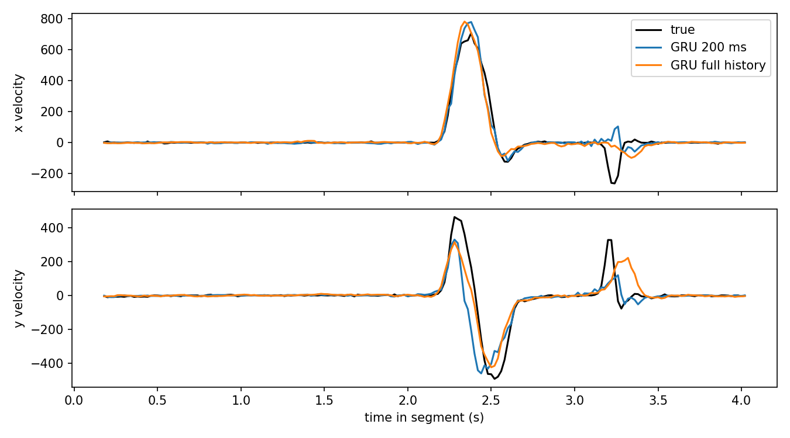

# Kalman Neural Decoder

A comparative study of neural decoding methods for predicting two-dimensional hand velocity from intracortical motor-cortex spike activity in the Neural Latents Benchmark (MC_Maze) dataset.

The reported experiments compare a multi-lag Wiener filter, a single-lag Kalman decoder, a Wiener–Kalman hybrid, and two GRU configurations.

> **Scope:** This is an offline analysis of an existing intracortical neural dataset. It is not a real-time BCI, a wearable EEG system, or a clinical device.

## Results

Reported test-set R² values (mean across X- and Y-velocity targets):

| Decoder | Temporal input | Test R² |
|---|---|---:|
| Wiener filter (ridge regression) | 200 ms history | 0.535 |
| Kalman filter (single-lag observation model) | One observation, 120 ms lag | 0.109 |
| Wiener–Kalman hybrid | 200 ms history | 0.545 |
| GRU | 200 ms window | 0.888 ± 0.002 |
| **GRU** | **Full-segment history** | **0.915 ± 0.002** |

The GRU values are reported as mean ± standard deviation across three random initializations. The other values are reported point estimates. These are results from the specific configurations evaluated here, not a universal ranking of model families.

### Interpretation

- The tested multi-lag Wiener filter outperformed the tested single-lag Kalman configuration.
- The Wiener–Kalman hybrid slightly exceeded the Wiener baseline in the reported evaluation.
- Both GRU configurations achieved higher reported test R² than the linear configurations.
- The full-segment GRU achieved the highest reported score.

The comparison does not isolate temporal context as the sole cause of the GRU performance difference. Model capacity, optimization, regularization, training procedure and input representation may also differ.

## Dataset and objective

- **Dataset:** Neural Latents Benchmark — MC_Maze.
- **Input:** Intracortical motor-cortex spike activity.
- **Target:** Two-dimensional hand velocity, represented as `v = [v_x, v_y]`.
- **Task:** Estimate hand velocity from neural observations.

The decoding objective is:

```text
v_hat[t] = f(s[1:t])
```

Here, `s[1:t]` denotes the neural observations available up to time `t`, and `f` is the decoding model.

## Models

### Wiener filter

The linear baseline uses ridge regression over a history window of neural observations.

```text
v_hat[t] = W^T * [s[t-L+1], ..., s[t]]^T + b
```

Where:
- `v_hat[t]` is the predicted two-dimensional velocity at time `t`.
- `W` contains the fitted regression coefficients.
- `s[t-L+1] ... s[t]` is the sequence of neural observations in the history window.
- `L` is the number of time bins in that window.
- `b` is the intercept.

The reported configuration uses a 200 ms history window.

### Kalman filter

The decoder is based on a linear state-space model:

```text
x[t] = A * x[t-1] + w[t]

z[t] = C * x[t-k] + d + v[t]
```

Where:
- `x[t]` is the latent kinematic state.
- `z[t]` is the neural observation.
- `A` is the state-transition matrix.
- `C` is the observation matrix.
- `k` is the observation lag.
- `w[t]` and `v[t]` are process and observation noise.
- `Q` and `R` denote their covariance matrices.

The reported configuration uses a single-lag observation model with a 120 ms lag. The precise state definition, lag convention, fitting procedure and covariance estimation must be verified against the executable implementation before attempting an exact reproduction.

### Wiener–Kalman hybrid

The reported hybrid configuration achieved a test R² of 0.545. Its exact construction should be described from the implementation before drawing broader conclusions about hybrid state-space methods.

### GRU

A gated recurrent unit network models temporal dependencies in the neural observations.

- **Windowed GRU:** 200 ms input window.
- **Full-segment GRU:** processes the available sequence across a segment.

The full-segment configuration achieved the highest reported score. This result applies to the evaluated implementation and does not prove that longer sequences always improve decoding.

## Validation status and limitations

The experiment summary supplied for this project reports the following controls:

- **Future-information perturbation:** replacing future tracking inputs with uniform random noise reportedly produced no change in the tested past-velocity predictions. This checks one specific perturbation; it is not a complete proof that the pipeline is free of temporal leakage.
- **Cross-trial control:** shuffling movement blocks across trials reportedly reduced performance to approximately R² = -1.0. Interpretation depends on the exact shuffle and split procedure.
- **Simulation check:** a Kalman-model simulation reportedly produced approximately R² = 0.55. This value is not sufficient to establish correct implementation or optimal estimation. Under a correctly specified linear-Gaussian model, with matched dynamics, observation model, noise covariances, initialization and evaluation targets, the Kalman filter should be an appropriate minimum-mean-square-error estimator. A substantially lower R² can arise from model/target mismatch, incorrect lag or time alignment, parameter estimation error, initialization/transient effects, noise covariance mismatch, or an R² calculation issue. The simulation generator, parameter values, initialization, burn-in, and metric calculation need to be inspected before this result can be explained conclusively.

The average-position baseline is not presented as a valid control for the velocity task. A position-prediction baseline and a velocity-prediction decoder have different targets and their R² values are not directly comparable.

**Reproducibility limitation:** the current public repository snapshot does not contain the reported `results.csv` file or the imported implementation modules referenced by `run_benchmark.py`. The benchmark script also requires a local preprocessed data file at `data/mc_maze_20ms.npz`. Consequently, the numerical results in this README should be treated as reported experiment results, not independently reproducible from the current public snapshot. The CSV is written by the script at runtime; it is not currently committed.

## What is needed for reproduction

A reproducible release should include or clearly document:

1. The decoder implementation modules imported by the benchmark script.
2. Instructions for obtaining and preprocessing the MC_Maze data, including the expected `data/mc_maze_20ms.npz` format.
3. Trial-level train/test split construction and the exact test segments.
4. Neural binning, normalization, smoothing and velocity-target alignment.
5. Kalman state definition, lag convention, parameter fitting, and covariance estimation.
6. GRU architecture, hyperparameters, training procedure and random seeds.
7. The exact R² definition and whether per-axis scores are averaged.
8. A committed results artifact generated by the documented evaluation command.

## Conclusion

In the reported experiments, the full-segment GRU achieved the highest test R² (0.915 ± 0.002). The single-lag Kalman configuration scored 0.109, below the multi-lag Wiener baseline at 0.535.

The defensible conclusion is that the evaluated configurations performed differently. The results do not show that Kalman filtering is inherently inferior. Its state-space specification, observation lag, parameter estimation and temporal representation require further controlled investigation.


